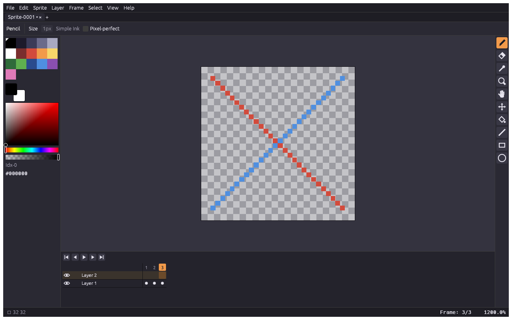

# UI design

> **Last updated:** 2026-10-20



## Layout

The target app's arrangement and proportions (measured: `plan/aseprite/observed-ui.md`), with our
own look. One module per panel in `crates/ui-egui/src/panels/`; sizes in `theme::size`.

```text
┌──────────────────────────────────────────────────────────────┐
│ menu bar: File Edit Sprite Layer Frame Select View Help      │
├──────────────────────────────────────────────────────────────┤
│ tabs: one per sprite, × closes, + new                 24 pt  │
├──────────────────────────────────────────────────────────────┤
│ context bar: options of the current tool              34 pt  │
├────────┬─────────────────────────────────────────────┬───────┤
│ colour │                                             │ tool  │
│ bar    │      sprite editor (checkerboard, sprite)   │ bar   │
│ 144 pt │                                             │ 36 pt │
│        ├─────────────────────────────────────────────┤       │
│palette │ timeline: transport · layers × frames 140pt │       │
│picker  │                                             │       │
├────────┴─────────────────────────────────────────────┴───────┤
│ status bar: pointer pixel, size · frame, zoom          24 pt │
└──────────────────────────────────────────────────────────────┘
```

| Panel | Module | Contents |
|---|---|---|
| Menu bar | `menu_bar.rs` | engine commands by `menu` path, plus the UI's view actions (`UiAction::MENU`) |
| Tabs | `tabs.rs` | open sprites (• = unsaved changes), × closes (`file.close`), + new (`file.new`) |
| Context bar | `context_bar.rs` | per tool: pencil/eraser size, ink, pixel-perfect; zoom/hand: 100 %, Center, Fit Screen |
| Colour bar | `color_bar.rs`, `color_picker.rs` | palette in 5 columns (click = foreground, right click = background, corner mark on the foreground), fg/bg swatches (click or X swaps), saturation/value square, hue and alpha strips, palette index and hex |
| Tool bar | `tool_bar.rs`, `icons.rs` | one icon button per tool, tooltips with the key |
| Sprite editor | `canvas.rs` | checkerboard, sprite texture (nearest above 100 %, linear below), 1 pt border |
| Timeline | `timeline.rs` | first/previous/play/next/last; frame numbers; per layer eye, lock, name and one cell per frame (dot = cel); active row, frame and cel highlighted; right click selects and opens New Frame / Delete Frame / New Layer |
| Status bar | `status_bar.rs` | `+ x y` under the pointer, `□ w h`, `Frame: n/total`, zoom `100.0%`; errors replace the left side |

## Lifecycle

As observed in the target app (`plan/aseprite/lifecycle.md`), tested in `crates/ui-egui/src/tests.rs`:

| Step | PixelCraft |
|---|---|
| Launch | Home tab only: the app icon, New File..., Open File..., Recover Files..., Recent files and folders (no News pane, by choice); status bar shows the version; title `PixelCraft v<version>` |
| File ▸ New... (Cmd+N, Home link) | **New Sprite** dialog with the last used values: width/height (width focused and selected), colour mode, background, Advanced Options; Enter = OK, Escape = Cancel |
| OK | tab `Sprite-0001` (numbers count up for the session, never reused), 100 % zoom centred, title `Sprite-0001 - PixelCraft v<version>`; white/black background makes an opaque `Background` layer |
| Edit the sprite | the tab's × becomes ● (unsaved changes); the title doesn't change |
| Undo back to the saved point | ● goes back to ×; closing no longer asks |
| Close (Cmd+W, tab ×/●) untouched | closes at once; with no sprite left, back to Home |
| Close modified | **Warning**: "Saving changes to the sprite "…" before closing?" Save / Don't Save / Cancel |
| Quit (File ▸ Exit, Cmd+Q, window close) | one Warning per modified sprite ("before quitting?"); Cancel stops the quit; Don't Save on the last one quits |
| Close Home | empty workspace with a small Home button; View ▸ Home reopens it |

Save stays disabled in the Warning until `.aseprite` writing lands (`docs/gaps.md`).

## Tool bar, hover and selection

As observed in the target app (`plan/aseprite/tools.md`):

- **Twelve group buttons**, each showing its group's last-used tool: Marquee (Rectangular,
  Elliptical, Lasso, Polygonal Lasso, Magic Wand) · Pencil, Spray · Eraser · Eyedropper ·
  Zoom, Hand · Move, Slice · Paint Bucket, Gradient · Line, Curve · Rectangle, Filled Rectangle,
  Ellipse, Filled Ellipse · Contour, Polygon · Blur, Jumble · Text. **Right-click or long press**
  opens the group as a strip to the button's left. A tool's key pressed again cycles through
  the tools sharing it (U: Rectangle ↔ Filled Rectangle).
- **Tooltips** in the target app's words (`Rectangular Marquee Tool:` / `* Left Button: …` /
  `Shortcut: M`); the status bar shows the hovered tool and its key.
- **Bottom buttons:** show/hide Preview (F7) and show/hide Timeline (Tab).
- **Hover:** brush tools fill the brush's pixels with the colour they would paint, outline them in
  negative black/white (black over light pixels, white over dark), and draw crosshair arms
  around; selection tools and Move show the crosshair only.
- **Drag:** every tool previews live and commits one command (one undo step) on release.
- **Selection:** marching ants (black/white dashes that move) along the selected pixels' edges;
  painting stays inside the selection; Select ▸ All / Deselect / Reselect / Inverse;
  Shift adds, Alt+Shift subtracts, Cmd+Shift intersects, the right button subtracts; a click
  without dragging deselects. The status bar shows the selection's size.
- **Preview window (F7):** floating, title row with three buttons like the target app — fit,
  ▶/■ (also Shift+Enter) and close. ▶ plays the animation **in the window**, looping over every
  frame at its own duration, while the editor stays on its frame; ■ stops. The wheel zooms the
  preview on its own, dragging pans it, fit fits it again.
- **Tab strip:** double-clicking the free space after the last tab opens New Sprite.

Not implemented yet (the buttons say so): Slice, Gradient, Curve, Blur, Jumble, Text.

## Preferences

Edit ▸ Preferences... (Cmd+, or Cmd+K, like the target app): sections on the left, options on the
right; OK applies and closes, Apply applies, Cancel or Escape discards.

| Section | Option | Default |
|---|---|---|
| Editor | Invert the mouse wheel zoom direction | off |
| Cursors | Use native mouse cursors | off (pixel cursors) |
| Cursors | Mouse Cursor Scale | 100 % |

Preferences are not saved between runs yet (`docs/gaps.md`).

## Zoom and navigation

`crates/ui-egui/src/zoom.rs`: 25 levels, `1/n` and `n` for n ∈ {1, 2, 3, 4, 5, 6, 8, 12, 16, 24,
32, 48, 64} (1.6 % to 6400 %), as measured in the target app.

| Input | Action |
|---|---|
| Wheel | one level per notch around the pointer (wheel up / swipe down = in; Edit ▸ Preferences ▸ Editor inverts it) |
| Shift + wheel | scroll sideways |
| Cmd/Ctrl + `=` / `-` | zoom in / out (around the pointer) |
| `` ` `` `1` `2` `3` `4` `5` `6` | 50 %, 100 %, 200 %, 400 %, 800 %, 1600 %, 3200 % |
| Cmd/Ctrl + `0` | fit on screen |
| Shift + `Z` | scroll to the centre |
| Space (hold), Hand tool `H`, middle button | pan |
| Zoom tool `Z` | click in, right click out |

A new sprite opens at 100 %, centred, like the target app (Cmd+0 fits it). Zoom and pan are kept
per document. The checkerboard squares are 16×16 sprite pixels, doubled while under 8 points.

## Keys

`crates/ui-egui/src/keys.rs` matches the **physical** key with exact modifiers, so shortcuts work
under any keyboard layout. Engine commands bind through their `shortcut` field; UI-only keys:

| Key | Action |
|---|---|
| B E I Z H V G L U, Shift+U | Pencil, Eraser, Eyedropper, Zoom, Hand, Move, Bucket, Line, Rectangle, Ellipse |
| Alt (hold) | eyedropper |
| Delete, Backspace | Edit ▸ Delete: clear the selected pixels (transparent; background colour on a background layer), or the whole cel with nothing selected; the selection stays |
| X | swap foreground and background |
| Tab | show/hide the timeline |
| Enter | play/stop |
| Left / Right, Home / End | previous/next, first/last frame (engine) |
| Up / Down | next/previous layer (engine) |
| Alt+N, Alt+C | New Frame, Delete Frame (the last frame can't be deleted) |

## Pixel look

A pixel-art interface, all of it original and drawn in code (nothing taken from the target app):

- **UI pixel = 2 points** (`theme::size::UI_PX`), like the target app's default 200 % scale.
- **Font:** PixelCraft's own pixel font (`pixel_font/glyphs.rs`, 5×7 capitals, x-height 5,
  2-pixel descenders), built into a TrueType font at start-up (`pixel_font/mod.rs`) and used at
  20 pt, where one font pixel is one UI pixel. Characters it lacks fall back to egui's fonts.
- **Skin:** no anti-aliasing on shapes, no rounded corners, no shadows; one-UI-pixel outlines;
  raised controls get a bevel (light top/left, dark bottom/right) and sink while pressed; the
  selected tool is an orange bevel (`theme::bevel`, `bevel_selected`, `sunken`).
- **Icons:** hand-drawn pixel bitmaps (`icons.rs`), scaled by whole points.
- **Cursor:** real OS cursors made from PixelCraft's own pixel sprites (`cursor.rs`): egui hands
  the RGBA image to the window system (`Context::set_cursor_image` → winit custom cursor), so the
  OS draws it everywhere — window, dialogs, popups, menus — with no lag and nothing left behind
  when the pointer leaves. Sprites: arrow, text I-beam, hand, horizontal/vertical resize, and a
  crosshair with an open centre over the canvas. Edit ▸ Preferences ▸ Cursors: "Use native mouse
  cursors" switches to the OS's own; "Mouse Cursor Scale" 100/200/300 %. The web build shows the
  standard cursors (no custom cursor support there yet).
- **Colours ("Dusk", `theme::Tokens::dusk`):** violet-grey panels, warm orange accent, yellow
  tooltips — deliberately not the target app's grey-blue and beige.

## Looking at the UI

```sh
cargo run -p pixelcraft-ui-egui --example snapshot -- --scale 1 \
  --cmd 'pixel.stroke={"x0":2,"y0":2,"x1":29,"y1":29,"color":"#d24b3c"}' --tool hand --zoom 4 out.png
```

Renders the whole window offscreen (no window, no focus stealing). kittest wraps the UI in an
8 pt margin that the real window doesn't have.
